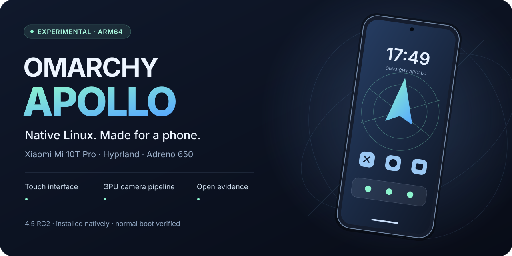
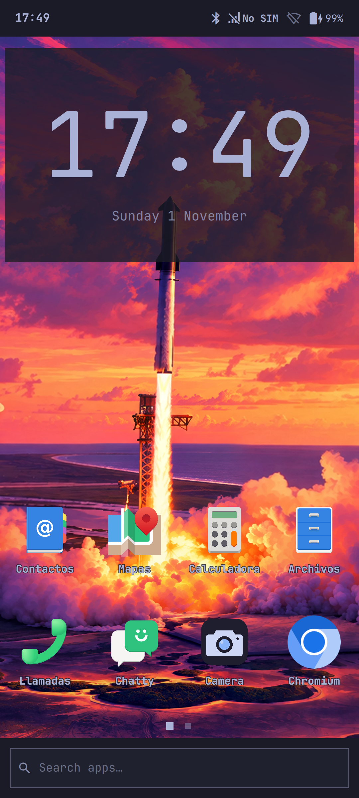

<p align="center"></p>

<p align="center">
  <a href="docs/status.md"></a>
  <a href="https://github.com/omacom/omarchy/releases/tag/v4.5.0-rc2"></a>
  <a href="docs/validation-2026-11-01.md"></a>
  <a href="LICENSES/README.md"></a>
</p>

<p align="center"><a href="docs/es/README.md">Español</a> · <a href="docs/status.md">Hardware status</a> · <a href="docs/validation-2026-11-01.md">Lab notes</a> · <a href="docs/roadmap.md">Roadmap</a> · <a href="CONTRIBUTING.md">Contribute</a></p>

**An independent effort to bring native Omarchy to the Xiaomi Mi 10T Pro (`apollo`).** A touch interface, the normal Linux desktop and a GPU camera pipeline on a Snapdragon phone — with the results and the gaps documented together.

> **Current track: Omarchy 4.5 RC2, latest RAM trial R12 on 2026-11-01.** These sessions boot native ARM64 Linux, without Android as the host. They returned to Android after each trial. **The new rebase is not permanently installed, is not a complete daily-driver phone, and has no validated public installer.** Earlier permanent-installation and Waydroid results belong to the [2026-10-30 historical track](docs/history/README-2026-10-30.md).

## On the device

<p align="center"><a href="media/apollo-home-r11.png"></a></p>

<p align="center"><em>Actual R11 device capture. The header artwork is an illustration; this is the tested interface. No camera photos, credentials or personal notifications are published.</em></p>

## What is demonstrated

- **Native desktop and touch.** ARM64, systemd, Hyprland and Quickshell on the internal display. Touch input, applications and the on-screen keyboard have been exercised.
- **Adreno GPU processing.** Freedreno reports **FD650**. All four camera sensors delivered 640×480 images; the main and ultrawide also passed larger RGB captures.
- **A usable phone session.** The ordinary local user can query calls without the startup PIN prompt. Daemon administration and firmware changes still require administrator authentication.
- **Measured changes.** Increasing CMA from 32 to **256 MiB** resolved the main-camera DMA allocation failure. Normal EFS service stop/restart and original boot/DTBO restoration were checked separately.
- **Physical haptics.** R12 exercised AW8697 rumble for **120 ms at 8192/65535 magnitude** (about 12.5%). The user confirmed a **very low-strength vibration**; normal-session access and feedbackd discovery were also checked.

| Component | Latest observed result | Still needed |
| --- | --- | --- |
| Display / GPU / touch | Native desktop, FD650, touch and keyboard | Wider app, accessibility and power testing |
| Main camera | 24 RGB frames at **3000×2256**; GPU pipeline; autofocus reported focused in a separate illuminated sequence | Optical quality, color, video and full-resolution support; **108 MP is unavailable** in this driver |
| Ultrawide / other cameras | Ultrawide: 24 RGB frames at **4200×3120**; all four sensors at 640×480 | Front high-resolution capture, macro focus, orientation and quality |
| Torch | Normal-user one-second on/off control passed | Visible-light confirmation |
| Modem / phone permissions | Modem detected; read-only call list succeeds; EFS stop/restart passes | **No SIM available:** real calls, SMS, data and call audio untested |
| Wi-Fi / Bluetooth | Wi-Fi device detected; Bluetooth service active | Actual Wi-Fi connection and Bluetooth pairing |
| Sensors / NFC | Accelerometer and ambient light available; NFC adapter registered | Proximity, NFC tag read and broader sensor acceptance |
| Haptics | R12: very soft physical AW8697 rumble; local-user access; feedbackd opens the device after restart | Strength, app feedback and a full boot of the newly packaged runtime |
| Infrared | R12: LIRC detected, capabilities `0x302` queried | **No signal transmitted:** optical emission and remote control untested |
| GPS / fingerprint | Unverified | Native end-to-end support and physical tests |
| Boot / updates / battery | Supervised RAM return and original partition readbacks checked | Permanent 4.5 installation, first PIN, standalone boot, coherent updates, suspend and battery life |

See the [full status and evidence links](docs/status.md). A detected device, an authorization check or a passing fixture is not a completed hardware feature.

## Start here

This repository contains the earlier integration, a [clearly separated 4.5 rebase record](docs/rebase-4.5.md), and [reviewable source patches](patches/rebase-4.5/README.md). The public build and recovery path for the new track is incomplete. **Do not flash these files or run a PC Omarchy installer on the phone.**

You can review the source and run the publication checks without connecting a phone:

```sh
git clone https://github.com/LucasLG92/omarchy-apollo.git
cd omarchy-apollo
python3 tests/check_public_docs.py
```

[Rebase and source pins](docs/rebase-4.5.md) · [How results are recorded](docs/validation-2026-11-01.md) · [Architecture and boundaries](docs/architecture.md) · [Historical recipes](docs/build.md)

## Help move it forward

The most useful contributions are small and reproducible: camera quality/orientation, sensor and device-driver work, phone UI/translation, audio and power measurements, and a reliable native update/recovery path. See the [roadmap](docs/roadmap.md) and [contribution guide](CONTRIBUTING.md) before testing on hardware.

If you want to follow the port, **star the repository**. Bug reports, careful reviews and real device evidence are especially welcome.

## Built on other people's work

This port depends on [Omarchy](https://github.com/omacom/omarchy), [Omarchy Mobile](https://github.com/derekross/omarchy-mobile), [Arch Linux ARM](https://archlinuxarm.org/), [Hyprland](https://github.com/hyprwm/Hyprland), [Quickshell](https://github.com/quickshell-mirror/quickshell), [libcamera](https://libcamera.org/) and the [Apollo hardware packages by royka1](https://github.com/royka1/Xiaomi-Apollo-pmOS-packages). Earlier Android-container work uses [Waydroid](https://github.com/waydroid/waydroid). This is an independent community project, not an official Xiaomi or Omarchy release.

Project integration is MIT licensed; imported components and patches retain their own licenses. See [license and attribution details](LICENSES/README.md) and [media provenance](media/README.md). Proprietary firmware, partition images, per-device calibration and credentials are not distributed. [Security and privacy](SECURITY.md).
