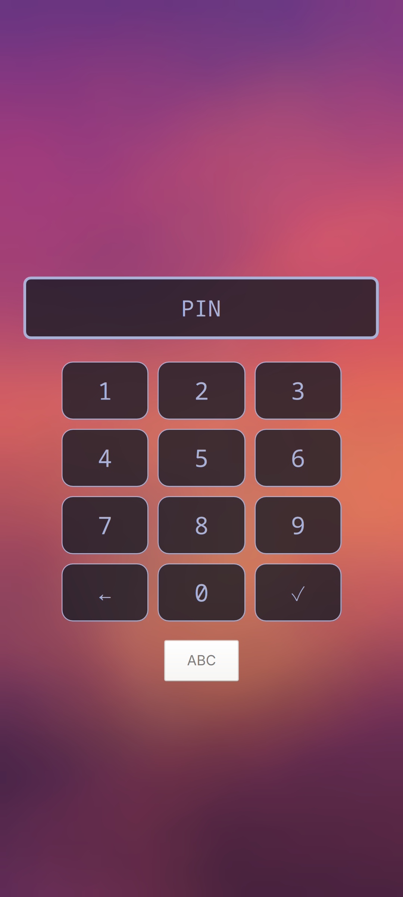

# Omarchy Apollo

**A native Omarchy desktop, adapted for a phone.**

 

Actual device captures: the native desktop and the touch-lock preview. Owner PIN setup and real screen unlocking are still awaiting validation.

Omarchy Apollo brings the Omarchy workflow to the Xiaomi Mi 10T Pro (`apollo`, M2007J3SG): a touch-friendly Linux desktop, phone-style locking and an optional Android environment for APKs without Google services.

This is an independent experimental port. It is not an official Omarchy image or a finished daily-driver release. The aim is full hardware support; the status below records what has actually been demonstrated.

## The approach

- Run on the phone's internal storage using the existing Apollo kernel and Android boot chain.
- Adapt upstream Omarchy for `aarch64-apollo`, preserving GPU, camera and other device-specific work.
- Keep a recoverable desktop during migration.
- Run ARM Android applications through Waydroid VANILLA, on demand.
- Add a touch PIN without publishing or collecting the owner's secret.

Omarchy now has ARM development builds. Apollo still needs its own integration: a Snapdragon phone is not a Snapdragon X laptop, and its boot layout is not a UEFI PC layout.

## Current progress

| Area | Evidence / current limit |
| --- | --- |
| Native Linux boot | Installed to internal storage; owner verified a cold boot without a PC on the inherited Apollo base |
| GPU | Native Omarchy compositor renders through Freedreno FD650; Waydroid reports FD650 OpenGL ES 3.2 |
| Cameras | Repeated captures, front-camera cycles and suspend checks passed on the inherited base; Omarchy application tests pending |
| Wi-Fi | 2.4 and 5 GHz scans and a 5 GHz connection verified on the inherited base; new shell interaction pending |
| Desktop | Native Hyprland 0.57.0 + Omarchy Quickshell session running on the internal panel; live configuration check is clean |
| Touch interface | Portrait scaling, a simplified status bar and keyboard toggle installed; physical touch acceptance pending |
| Android | VANILLA ARM image boots; FD650 rendering verified; signed F-Droid 2.0.2 APK installed and repository update completed; launch lifecycle and reboot tests continue |
| Touch lock | PIN verifier and real PAM conversation pass 15 device-local checks; trusted keypad rendered on device; owner PIN setup and real unlocking pending |
| Fingerprint | Contact detected previously; enrollment and unlock not implemented |
| Mobile network | No SIM available for calls, SMS or data tests |
| GPS | Service integration exists; outdoor accuracy and reliability remain to be validated |
| USB-C video | Direct cable test produced no image; display output is not supported by this port today |

See [validation](docs/validation.md), [architecture](docs/architecture.md) and [roadmap](docs/roadmap.md). A feature moves to “working” only with device evidence. Inherited results do not imply that a new Omarchy application has passed the same test.

## Source layout

`PKGBUILD` and `packaging/` contain the desktop, keyboard, lock and Android recipes. `patches/` contains the small Apollo changes against a pinned upstream commit. `platform/` owns phone-specific lifecycle boundaries. `config/` contains the touch profile. `lock/` contains local PIN setup and verification; `tests/` contains its device-local authentication checks. `hardware/apollo-base/` preserves the earlier kernel patches, system services, tests and recovery work, with its original licensing and provenance.

This repository intentionally excludes firmware binaries, partition images, device backups, private diagnostics, network names, account information and credentials. Do not flash a generic Omarchy ARM ISO onto this phone.

[Español](docs/es/README.md) · [Contributing](CONTRIBUTING.md) · [Security and privacy](SECURITY.md)

## Credits

[Omarchy](https://github.com/omacom/omarchy), [Omarchy packages](https://github.com/omacom/omarchy-pkgs), [Arch Linux ARM](https://archlinuxarm.org/), [Hyprland](https://github.com/hyprwm/Hyprland), [Quickshell](https://git.outfoxxed.me/quickshell/quickshell), [Waydroid](https://github.com/waydroid/waydroid), Linux and the Apollo device-port contributors make this work possible. Omarchy is MIT licensed; Linux and individual dependencies retain their respective licenses. This project does not redistribute proprietary Xiaomi firmware.
