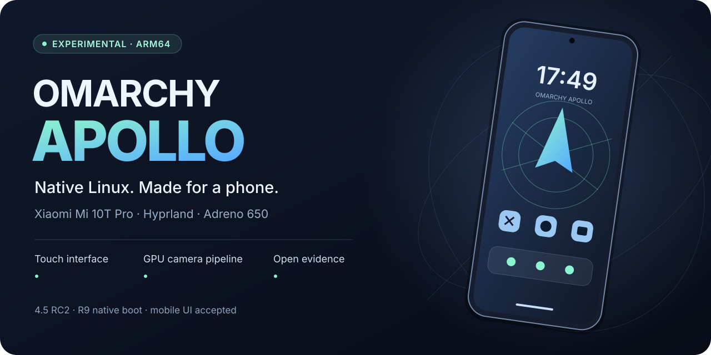
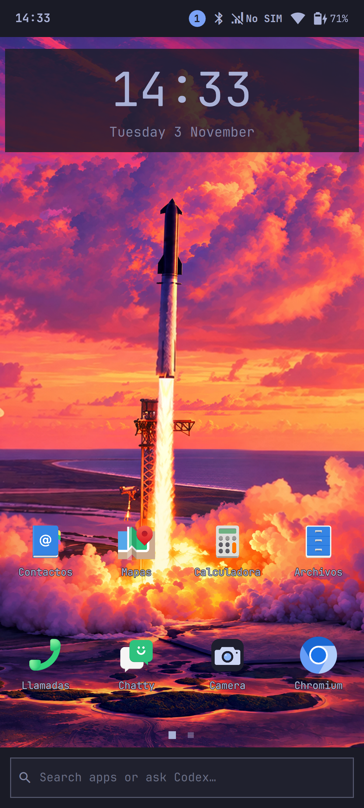
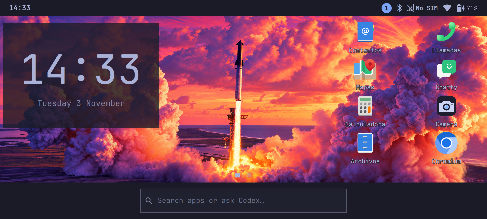

<p align="center"></p>

<p align="center">
  <a href="docs/status.md"></a>
  <a href="docs/kernel-7.3.1.md"></a>
  <a href="https://github.com/omacom/omarchy/releases/tag/v4.5.0-rc2"></a>
  <a href="docs/gallery.md"></a>
</p>

<p align="center"><a href="docs/es/README.md">Español</a> · <a href="docs/gallery.md">Gallery</a> · <a href="docs/status.md">What works</a> · <a href="docs/kernel-7.3.1.md">Kernel</a> · <a href="docs/roadmap.md">Roadmap</a> · <a href="CONTRIBUTING.md">Contribute</a></p>

**Native Omarchy on the Xiaomi Mi 10T Pro (`apollo`).** A real Linux desktop with a touch Home screen, mobile gestures and native applications, running from the phone's internal storage.

**Current milestone · 3 November 2026:** Linux **7.3.1 R14**, accelerated Adreno graphics, persistent repaint fixes and a faster, frame-aware rotation handoff. This is an independent experimental port, tested on one Pro development unit. [Latest results and limits](docs/milestone-2026-11-03.md).

## On the phone

<p align="center"><a href="media/apollo-home-portrait-r33.png"></a></p>

<p align="center"><a href="media/apollo-home-landscape-r33.png"></a></p>

<p align="center"><em>Fresh captures from the Apollo itself, with the installed R14 kernel and shell29. No mockups. The SIM was removed for this session. Icons show installed apps, not completed hardware support. <a href="docs/gallery.md">Phone, Recents and capture provenance →</a></em></p>

## What you can see working

- **Native boot and local login.** Internal ext4 root, normal systemd boot and the owner's local desktop session. Existing-account login and authenticated administration have been tested; clean first-user provisioning still needs end-to-end acceptance.
- **Touch Home and gestures.** Clock, app shortcuts, search, swipe Home, hold for Recents and keyboard dismissal. The earlier last-app-close → Home flow was human-confirmed.
- **Applications fit the workarea.** The persistent repaint compatibility fix addresses reported fragments during app switching and keyboard changes. A real GTK window followed **960×372 → 960×192 → 960×372** as the keyboard opened and closed, without changing fonts, zoom or display scale.
- **Rotation with a prepared frame.** The compositor holds the old image until the new scene has been composed. Four on-device transactions measured **0.50–0.68 seconds**, excluding sensor detection time; bars fitted, the wallpaper did not reload and the display/touch pairing was restored. This measures those transactions, not every application's latency.
- **Recents survives burst closing.** The intermittent black screen was reproduced as a shell restart. Incremental window rows and bounded Home-frame acknowledgement passed **three bursts of five disposable windows**, with the same shell process and no wallpaper reloads.
- **Refresh-rate choice.** Manual **60 / 90 / 120 / 144 Hz** and an automatic **90 Hz on battery / 144 Hz while charging** policy are available. Sustained energy and thermal comparisons remain to be measured.

## Kernel: Linux 7.3.1, with the Apollo hardware port

R14 is a port to the signature-verified Linux 7.3.1 release, with **502 modules**, updated panel/camera/firmware interfaces and preserved device support. It is more than a release-name change.

| Implemented or retained | What it means |
| --- | --- |
| ThinLTO | Link-time optimization with normal ARM64 position-independent kernel link settings preserved |
| CPU scheduling and idle | Stock frequency limits, EAS/schedutil retained; `menu` remains selected, with TEO available for comparison |
| GPU runtime power management | Hardware MSM EGL verified, without llvmpipe; the GPU can runtime-suspend between activity |
| USB-C/PD charge policy | Follows the advertised current budget, clamps/rounds limits and retains thermal/AICL protections; **3,341 policy cases** passed |
| Memory management | MGLRU active; zram supports LZO-RLE, LZ4 and Zstd, with LZO-RLE still the boot default |
| Device-tree and security checks | **646 DT checks**, reserved-memory layout preserved, Landlock ABI 11 verified |

There is **no measured battery-life improvement or blanket performance percentage**. Overclocking, undervolting and removing thermal protections are not part of these changes. [Kernel changes, provenance and validation scope](docs/kernel-7.3.1.md).

## Hardware: working results and remaining gaps

| Area | Demonstrated | Remaining work |
| --- | --- | --- |
| Display, GPU, touch | Native accelerated desktop, touch UI, rotation/workarea checks and current Home captures | Wider app, reboot, accessibility and long-session coverage |
| Wi-Fi | Connected and HTTPS verified on R14 | Both bands, sustained transfer, reconnect and suspend/resume |
| Cameras | Earlier RGB capture from all four sensors; main **3000×2256**, ultrawide **4200×3120**. R14 drivers and CAMSS graph present | Revalidate image quality/video on R14; the main driver has **no 108 MP mode** |
| SIM and cellular data | Earlier local SIM-PIN continuation and automatic-profile IPv4 HTTPS passed on one network | Not retested on R14 with a SIM; more operators, IPv6 and reconnection |
| Calls | GNOME Calls with Omarchy appearance; earlier manual voicemail/downlink success | **Speakerphone unresolved:** distortion and a later unexpected restart were reported. Uplink, incoming calls, SMS and AEC remain open |
| Sensors and haptics | Earlier accelerometer/light checks and a physically confirmed, very soft AW8697 vibration | Proximity, strength, broader app feedback and R14 acceptance |
| Optional Android apps | Earlier Android 13/Freedreno and F-Droid installation/independent app windows passed | Uses **Waydroid**, not native Linux APK execution; broader apps/hardware and R14 retesting; no Google Play/GMS included |
| GPS / fingerprint | Research and prerequisites only | **No verified GPS fix; fingerprint enrollment and unlock are not operational** |
| Power / charging | Runtime power mechanisms and charge-policy integration checked | Physical suspend/wake, battery life, shutdown/cold-plug behavior and powered-off charging animation |
| Bluetooth / NFC / IR | Earlier service/interface detection | Pairing/audio, NFC tag transactions and actual IR transmission |

An icon, driver binding, screenshot or passing fixture is not full hardware acceptance. [Detailed status](docs/status.md) · [Prior trials](docs/validation-2026-11-02.md).

## Review the project

This repository contains source integrations, selected patches and sanitized test records. **A complete public R14 builder, generic flash image and end-to-end installer are still pending.** The development boot image contains device-specific configuration and is not distributed.

```sh
git clone https://github.com/LucasLG92/omarchy-apollo.git
cd omarchy-apollo
python3 tests/check_public_docs.py
```

[Build/rebase scope](docs/rebase-4.5.md) · [Historical build recipes](docs/build.md) · [Recovery and transfer record](docs/internal-root-transfer.md) · [Security and privacy](SECURITY.md).

### What about the regular Mi 10T 5G?

The shared `apollo` platform is promising, but this adaptation is tested **only on the Pro development unit**. The regular model's main camera, RAM/storage profile and own calibration need separate validation. It is not a confirmed direct-flash target. [Model matrix](docs/compatibility.md).

## Help move it forward

Useful contributions include phone/audio routing and AEC, suspend and energy measurements, cameras, sensor drivers, responsive application layouts and a reproducible native update/recovery path. [Open priorities](docs/roadmap.md) · [Contribution guide](CONTRIBUTING.md).

**Star the repository to follow the port.** Reproducible reports, source reviews and careful device testing help turn these milestones into a dependable phone.

## Credits and licenses

Built on [Omarchy](https://github.com/omacom/omarchy), [Omarchy Mobile](https://github.com/derekross/omarchy-mobile), [Arch Linux ARM](https://archlinuxarm.org/), [Hyprland](https://github.com/hyprwm/Hyprland), [Quickshell](https://github.com/quickshell-mirror/quickshell), [libcamera](https://libcamera.org/), [the Apollo hardware packages by royka1](https://github.com/royka1/Xiaomi-Apollo-pmOS-packages) and optional [Waydroid](https://github.com/waydroid/waydroid). This is not an official Xiaomi or Omarchy release.

Project integration is MIT licensed; upstream components, icons, wallpaper, original Omarchy branding and imported patches retain their own authorship and licenses. [Attribution](LICENSES/README.md) · [Media provenance](media/README.md). No credentials, biometrics, partition images, proprietary firmware or per-device calibration are published.
