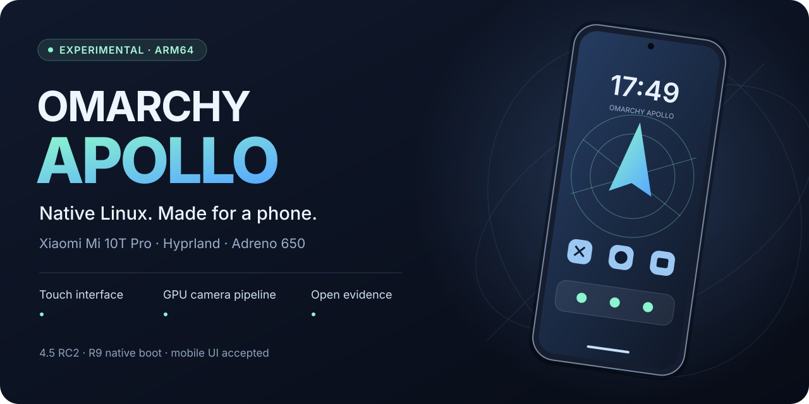
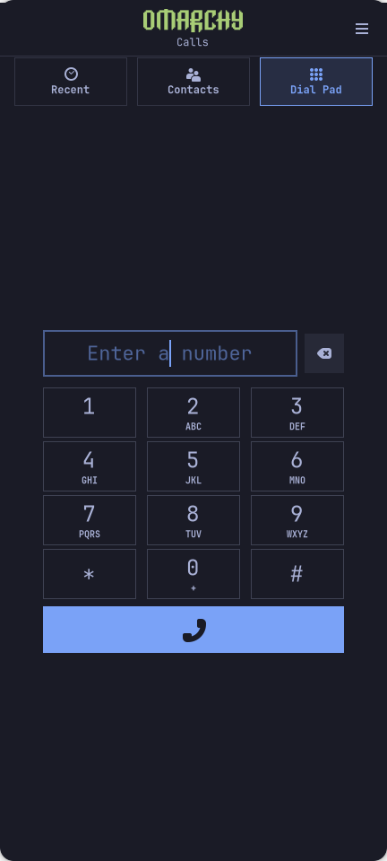
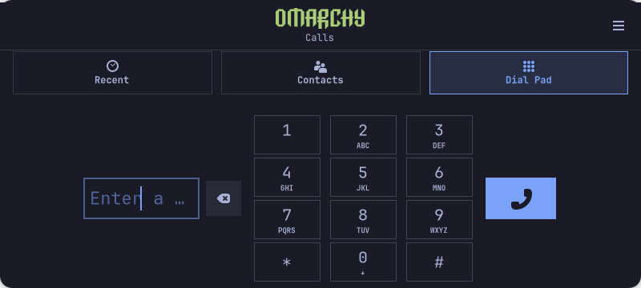

# Omarchy Apollo

**Omarchy 4.5 RC2 nativo en el Xiaomi Mi 10T Pro.** Proyecto comunitario independiente,
experimental y probado en una unidad Pro. [English](../../README.md) · [Estado completo](../status.md).

## Lo nuevo, ya comprobado

- **R9 permanente:** arranque normal desde la memoria interna, Landlock ABI9 y 503 módulos verificados; recuperación/DTBO conservados.
- **Escritorio aceptado tras reiniciar:** Hyprland 0.57.0-2.1 con tres parches upstream de feedback DMA-BUF. Supera el estado pendiente del escritorio negro para esta configuración probada; no promete fiabilidad ilimitada.
- **Teléfono con aspecto original de Omarchy:** GNOME Calls 51.1.apollo3-1 instalado y aceptado, logo oficial intacto, marcos, números y navegación adaptados.
- **SIM 0.2.2-1 sin saltos:** continuidad aceptada en la misma prueba. El PIN se introduce solo en el móvil; no hay reintentos automáticos.
- **Gestos aceptados:** Inicio, recientes, cerrar teclado y volver a Inicio al cerrar la última app.
- **Giro 0.3.1-3 activo:** el usuario observó que gira, pero siguen abiertos los tamaños y la adaptación visual/táctil completos. El pager se realinea al cambiar el área útil.

 

Estas imágenes son **renders de la aplicación real en el ordenador con datos
sintéticos**, no capturas privadas del móvil. Se probaron cuatro tamaños,12 teclas,
tres controles de navegación y objetivos táctiles de al menos 44 píxeles, sin marcar
llamadas y sin avisos GTK/CSS/plantillas. La aceptación humana del móvil se registra
por separado. [Detalle y evidencia saneada](../mobile-milestone-2026-11-02.md).

## Funciones y límites

La instalación interna, el acceso SDDM/PAM y la administración autenticada están
comprobados. R19 confirmó una llamada manual al buzón y audio descendente; R20
verificó HTTPS IPv4 por datos móviles, también con Wi-Fi apagado, en una red.
Wi-Fi, capturas de las cuatro cámaras, acelerómetro/luz y vibración muy suave
tienen pruebas concretas. La principal no ofrece 108 MP con este controlador.

Faltan micrófono/uplink, llamadas entrantes, SMS, IPv6, otras redes, GPS, huella,
proximidad, transmisión IR, Bluetooth/audio, suspensión física y autonomía.
Un diagnóstico posterior de vídeo Venus completó180 fotogramas/6 segundos sin el
aborto intermitente anterior; la causa sigue abierta y no hay mejora de batería
ni porcentaje de velocidad demostrado. El antiguo dato USB de 0,47 W está retirado.

**APK con icono y ventana propios:** el arranque en frío desde el icono de F-Droid ya pasó sin escritorio Android. El guard de Inicio pasó el ciclo real en vertical/horizontal y se cancela al reabrir la app. Las barras pasaron el ciclo automático; falta repetir su prueba física posterior a 19.

**Android 13/API 33 ya arrancó con Freedreno/Adreno:** HTTPS 204 y F-Droid oficial
instalado mediante el manejador APK/MIME normal, con actividad y proceso comprobados.
También pasó cerrar Android y abrirlo desde su entrada normal, con F-Droid y HTTPS 204
comprobados sin arranque LXC de diagnóstico. La revisión física conjunta sigue pendiente. VANILLA no incluye Google Play/GMS.
[Fuentes, resultado y límites](../mobile-layout-android-2026-11-02.md). El asistente r3 ya está instalado en R9 como userland 0.1.0-3/perfil 20261101-11:
se comprobó la integración sin alterar el propietario existente ni abrir el alta.
**Crear una primera cuenta y su primer acceso real sigue pendiente**.

## Código para revisar

[Parche upstream Hyprland](../../patches/hyprland-dmabuf/README.md) ·
[Teléfono](../../patches/phone-omarchy/README.md) ·
[Continuidad SIM](../../experiments/sim-continuation/README.md) ·
[Giro](../../experiments/mobile-rotation/README.md).

Son fuentes seleccionadas con sus licencias, no un instalador completo ni una
imagen para flashear. El Mi 10T normal sigue sin validar: necesita comprobar cámara
principal, almacenamiento/RAM y calibración propia. [Compatibilidad](../compatibility.md).

Las [pruebas anteriores](../validation-2026-11-01.md) y el [historial R20](../validation-2026-11-02.md)
conservan su alcance. No se publican firmware, imágenes de particiones, calibración,
credenciales, identificadores, redes, fotos privadas ni registros brutos.

Para colaborar: [guía](../../CONTRIBUTING.md), [hoja de ruta](../roadmap.md) y
[créditos/licencias](../../LICENSES/README.md). Puedes dar una **estrella** para
seguir los avances; las revisiones y pruebas reproducibles son igual de útiles.
