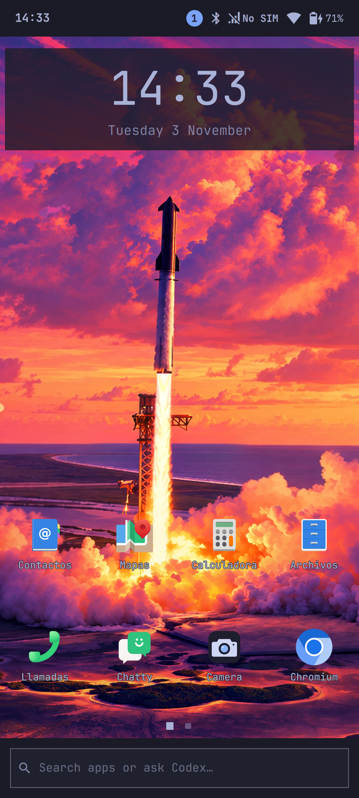
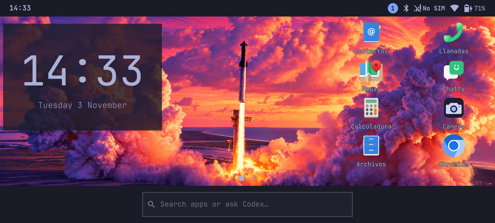
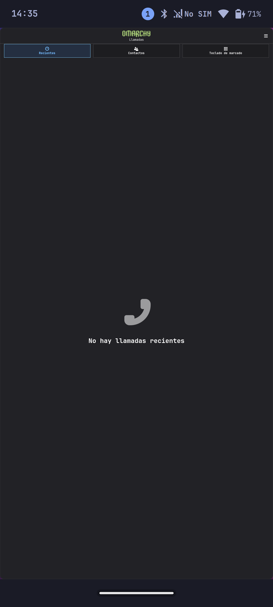
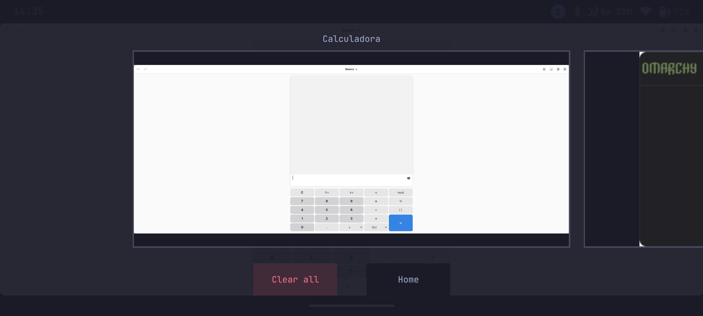

# Apollo gallery

**3 November 2026 · actual Mi 10T Pro display captures.**
These images come from the installed native system: Linux 7.3.1 R14,
Hyprland 0.57.0-2.4 and mobile shell29. They are not host renders or an Android
desktop. [Current milestone](milestone-2026-11-03.md) · [English](../README.md) ·
[Español](es/README.md).

## Home, portrait

Clock, shortcuts and the bottom search field on the real 1080×2400 output.
The SIM was removed; the status bar's “No SIM” is expected. An app icon is
not proof that its related hardware feature has passed acceptance.

## Home, landscape

2400×1080 landscape output, with compact bars and the same installed Home.
This captures the settled layout; it does not measure transition smoothness.

## GNOME Calls with the Omarchy appearance

The real installed application on the handset, using **disposable configuration,
empty history and the dummy voice provider**. This is a UI capture, not a call
or audio test. No subscriber, contact, number or recent-call record is shown.
GNOME Calls remains the selected dialer; speakerphone is still unresolved.

## Recents

Only the owned, disposable Calculator and Calls instances were open. No personal
calculation or call data was used. The screenshot shows the overview; the
separate [15-window closing test](milestone-2026-11-03.md#recents-reproduce-the-black-screen-then-stop-the-shell-restart)
checks stability rather than inferring it from a still image.

## Provenance

All four images were manually reviewed before publication and retained as
captured, without UI retouching. PNG text/EXIF chunks are absent. Their source,
dimensions and SHA-256 values are recorded in the
[sanitized evidence](evidence/2026-11-03-r14-ui.json) and repository-wide
[source manifest](../SOURCE-SHA256.json).

The clock, stock application labels/icons, wallpaper and generic connection
status are visible. No passwords, SIM PINs, account names, network names,
subscriber identifiers, personal notifications, messages or camera photos are
published. Display orientation/touch pairing and workspace were restored;
the disposable app services were stopped.

Upstream application/UI, wallpaper and icon authors retain their licenses.
The original Omarchy wordmark retains its DHH MIT attribution. The project's
MIT license does not relicense all screenshot contents. [Media details](../media/README.md).

The older [R11 Home](../media/apollo-home-r11.png),
[R16 boot capture](../media/apollo-boot-r16.png) and
[GNOME Calls host fixtures](../patches/phone-omarchy/README.md) remain available
as dated material. They do not depict the current R14 UI or prove current
boot-animation/audio acceptance.
