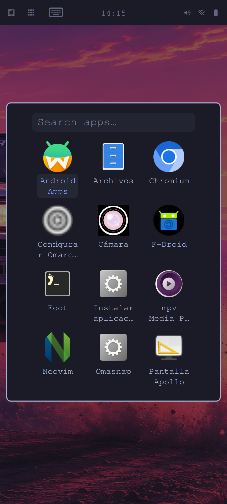

> **Historical snapshot — 2026-10-30.** These claims belong to the earlier installation. They are not acceptance evidence for the current 4.5 RC2 RAM rebase. See the [current status](../status.md).

# Omarchy Apollo

**Omarchy on a Snapdragon phone. Native Linux, touch-first controls, Android apps when you need them.**

  

Actual device captures, reviewed for personal data. The lock image is an empty preview with input disabled; it contains no entered PIN. The desktop and app grid come from the clean installation.

Omarchy Apollo is an independent project bringing the normal Omarchy workflow to the **Xiaomi Mi 10T Pro** (`apollo`, M2007J3SG). Its mobile integration is developed here: a reachable app launcher, touch keyboard, screen controls, numeric authentication and phone-style power-button behavior, on native Arch Linux ARM.

The clean installation is now **permanent**. The owner powered the phone off, disconnected the PC, booted with the power button and unlocked with the local PIN. The same PIN also authorizes administration through a touch keypad. New Android installations offer **without Google** or **with Google Play and services**; the tested phone uses the lighter VANILLA profile.

This is a working development port with important hardware gaps. It is not an official Omarchy image or a finished daily-driver release. Full phone functionality is the target; the evidence below defines the current result.

## What makes it a phone

- **Start independently.** Native desktop on internal storage, with accepted unplugged cold boot and a preserved recovery route.
- **Use a numeric PIN.** Create it on the phone, unlock the trusted session lock and use it for administration if selected. No mandatory long-password step in this profile.
- **Press the power key naturally.** Screen-off hides the keypad before blanking; waking requires the PIN. The owner confirmed this cycle.
- **Reach apps by touch.** A dedicated button opens the responsive application grid. The on-screen keyboard and display controls accompany the normal desktop workflow.
- **Run Android on demand.** Fresh ARM Android uses the Adreno GPU. The APK installer confirms Android's actual result; F-Droid persists across container restarts.
- **Keep development recoverable.** Reviewed packages, matching boot artifacts, private backups and an explicit boundary around the device stack.

## Current status

| Area | Demonstrated result | Remaining acceptance |
| --- | --- | --- |
| Clean installation | Signed Arch Linux ARM base; no old home, credentials, saved networks or Android data imported; no KDE/Plasma or CachyOS | Public installer from stock Android |
| Permanent boot | Boot image read-back checksum matches; owner-confirmed cold boot without PC and PIN unlock | Repeated power cycles and long-duration reliability |
| Desktop and GPU | Native Hyprland/Quickshell on 1080 × 2400; FD650 in Linux and fresh Android; clean configuration diagnostics | Broader application and suspend stress |
| Lock and administration | Physical PIN unlock, accepted numeric authorization popup and clean power-key cycle; corrected automatic lock protects the real session and turns the display off after two minutes | Physical wake/PIN acceptance for the automatic cycle; broader failure/suspend scenarios; fingerprint unlock |
| Touch interface | Dedicated apps button and actual native grid; keyboard candidate and installed binaries each pass 19 checks | Finger typing across toolkits, navigation polish and accessibility |
| Display controls | Orientation, automatic rotation, position lock and refresh; 23 isolated checks include the real accelerometer | Physical motion, touch mapping and power measurements |
| Wi-Fi | Both bands scanned; shell model receives all three 5 GHz-only networks in the comparison, none missing | Physical selector and connection acceptance in this clean base |
| Android / APK | Fresh VANILLA passes 31 install/lifecycle checks; F-Droid persistence and FD650; later running in a native window after host cold boot | Stopped-state icon launch, touch, notifications, camera and microphone |
| Google choice | VANILLA/GAPPS chooser and 27 isolated initializer checks; VANILLA boots | Actual GAPPS initialization and Google Play |
| Cameras | Earlier Omarchy build streams all four; EGL fix passes 40 candidate opens / 1,200 frames and 12 installed opens | Repeat preview, photos, video and orientation in the clean base |
| Audio | Owner heard native tones in the preceding Omarchy build; Android stereo transport verified with an isolated sink | Fresh-base speaker/microphone and Android physical audio |
| Clock | Calibrated read-only PMIC restoration installed; actual restore service and 12 fixture cases pass | Counter continuity after the next complete power-off |
| Fingerprint | Earlier contact detection | Enrollment, verification and unlock are not implemented |
| Cellular | Modem integration retained | No SIM available for calls, SMS or mobile-data tests |
| GPS | Service integration retained | Outdoor fix, accuracy and reliability |
| USB-C video | Direct cable test produced no image | Display output is unsupported by this port today |

The [clean-install record](../../docs/clean-install.md) separates physical acceptance, automated checks and inherited hardware results. Test counts describe their actual scope; a rendered screen or passing fixture does not establish every phone function.

## Recent engineering work

An automatic-lock failure was reproduced and corrected in Quickshell's idle notification lifetime. A replacement notification could reuse the old address, leaving the shell bound to a deleted object even though the compositor sent the idle event. The original reproduction fails and the corrected packaged production binary passes. All nine selected graphical unit targets pass; the real two-minute idle cycle now securely locks the session and turns the internal display off. Physical wake/PIN acceptance for this cycle is still pending. See the [focused patch and recipe](../../packaging/quickshell) and [device evidence](../../docs/evidence/idle-notification-lifetime-2026-10-30.json).

Runtime revision 12 packages reviewed upstream Omarchy commit `717175d4a8c5a12f6c0fff10dcc3c1c08ef3a0d1`. All seven Apollo patches apply without fuzz. Three changed upstream test suites and installed package-integrity checks pass. The update preserved open applications, the kernel, the PIN policies and the accepted power-key helper.

A production authentication bug is fixed: sudo/polkit can call PAM with a real root UID, whereas screen locking calls it from the desktop user's context. The verifier resolves the target from `PAM_USER` only for a real root caller, preserving unprivileged identity restrictions. A negative control reproduces the old failure; the fixed helper passes real root-PAM and sudo cases. The owner separately confirmed popup acceptance.

A desktop stall was traced to a lost wakeup in the graphics resource gatherer. Corrected `hyprgraphics` completes 512 resources in the candidate and another 512 after installation. It is active in the compositor after restart and cold boot; long-duration stability remains open.

The clock helper pairs trusted UTC with the existing PMIC counter to restore time offline. Automatic recalibration requires synchronized network time. It does not enable hardware RTC writes or change firmware storage. See [clock behavior](../../docs/clock.md) and [update evidence](../../docs/evidence/upstream-and-clock-update-2026-10-30.json).

## Explore the project

[Clean installation](../../docs/clean-install.md) · [Android](../../docs/android.md) · [Keyboard](../../docs/keyboard.md) · [Display](../../docs/display.md) · [Cameras](../../docs/cameras.md) · [Validation](../../docs/validation.md) · [Architecture](../../docs/architecture.md) · [Updates](../../docs/updates.md) · [Roadmap](../../docs/roadmap.md)

`platform/`, `config/` and `lock/` contain the mobile integration. `patches/` adapts pinned Omarchy. `packaging/` contains component recipes and `tests/` reproducible checks. `hardware/apollo-base/` preserves the earlier kernel patches, services and recovery work with their original provenance.

Firmware binaries, personalized images, partition backups, private diagnostics, network names and credentials are excluded. This is source and evidence for one device port, not a generic flashable ARM ISO.

[Español](../../docs/es/README.md) · [Contributing](../../CONTRIBUTING.md) · [Security and privacy](../../SECURITY.md)

## Upstream software and licensing

Apollo's mobile integration is developed in this project. Its underlying software retains its own authorship and licenses: [Omarchy](https://github.com/omacom/omarchy), [Omarchy packages](https://github.com/omacom/omarchy-pkgs), [Arch Linux ARM](https://archlinuxarm.org/), [Hyprland](https://github.com/hyprwm/Hyprland), [Quickshell](https://github.com/quickshell-mirror/quickshell), [Waydroid](https://github.com/waydroid/waydroid), Linux and the Apollo device-port contributors. Omarchy and the original Apollo integration are MIT licensed; Linux and individual dependencies retain their respective licenses. Proprietary Xiaomi firmware is not redistributed.
