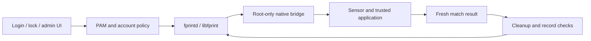

# R15: real fingerprint enrollment and a prepared system-authentication path

**4 November 2026 · one Mi 10T Pro development unit.** Linux 7.3.1 R15
(`r15-ddr-pm1`) and Hyprland 0.57.1 are installed. The fingerprint sensor has
captured, enrolled, persisted and matched a real finger, and rejected another.
The standard fprintd/PAM integration is prepared and signed on the PC;
**initial login, lock and administration with a finger are not activated yet**.
[Selected evidence](evidence/2026-11-04-r15-fingerprint.json) ·
[Reviewed sources](../experiments/native-fingerprint/README.md) ·
[Pruebas pendientes](pruebas-pendientes.md).

## What actually passed on the phone

- One finger enrolled with 29 secure captures. Its authenticated encrypted
  database was saved only on the phone and reloaded into the trusted application.
- A new verification run recognized that finger after reload. A different real
  finger returned no match. The user confirmed all three outcomes.
- Secure services stopped and the sensor module unloaded after each trial.
  An interrupt or touch event is not treated as authentication.
- Earlier error -30 was traced through the native Gatekeeper/RPMB service path.
  The corrected UFS transport and service readiness allowed real authorization;
  secure MAC/counter checks remain in the device's secure services and storage.
  No token is forged, no RPMB key is programmed and no raw biometric is exported.
- A service-sandbox startup conflict previously caused a freeze and required a
  physical bootloader reboot. Mandatory readiness/identity checks were corrected;
  the existing credential worked after recovery and the user confirmed normal UI.
  This recovery is not a claim that all possible freezes are solved.

## Installed desktop, applications and update engine

Hyprland **0.57.1-1.1** retains the mobile patches, with Aquamarine **0.15.1-1.3**.
The user accepted Home/icons/widgets and rotation, bars, windows and keyboard.
The original-style login now appears centered with a short reveal, and the
wallpaper was accepted. Wider reboot and long-session coverage remains open.

Chromium was restored and the alternative browser removed. Android/Waydroid
remains removed; optional apps and services need individual mobile acceptance.
ZapFast is installed but has not been linked or had its workflow tested.

The recoverable userspace selector has now booted on hardware and is installed.
A harmless signed marker candidate booted, payload/ALPM mounts were paired and
the current generation's health was accepted. This supersedes the inactive
selector state in the [3 November checkpoint](checkpoint-2026-11-03.md).
Forced-failure recovery, wider interrupted-update tests, migrations and a public
maintained channel remain unfinished. **Automatic kernel updates and unrestricted
upstream system upgrades are not enabled.**

## Ready on PC, waiting for physical acceptance

| Component | Prepared result | Handset acceptance |
| --- | --- | --- |
| Native libfprint/fprintd provider | ARM64 adapter and root-only native socket bridge, no Android HAL/container | Not installed/tested yet |
| Huellas | Guided first enrollment and verification through standard fprintd | The earlier trial UI passed; this app still needs handset acceptance |
| Initial SDDM login | Explicit «Usar huella», retaining password entry | Pending |
| Omarchy lock | Separate fingerprint PAM conversation and password alternative | Pending |
| sudo / polkit | Empty response or Huella selects fingerprint; typed password uses original auth immediately | Pending |
| Configuration / rollback | Root-only acceptance gate, local backup, partial-write recovery and managed restore | Software fixtures passed; real route checks pending |

The prepared cohort has seven signed packages and a four-package rollback.
Installing it alone does not enable fingerprint PAM. The existing finger must
be adopted through metadata, not enrolled again or replaced. Activation waits
for a real standard-provider match and rejection test.

## Checks and limits

PC checks include **340 real ARM64 Linux-PAM cases under QEMU**, **32 libfprint
fake-bridge cases**, **1,732 native decision-gate cases**, **11 disposable-root
configuration/restore cases**, and actual ARM64 Qt layout/choice/cancel checks
with synthetic native agents. Signed package contents/manifests were audited.
None of these fixtures is a physical fingerprint unlock test.

Only the primary local owner and one enrolled finger are supported in this first
profile. Multi-finger management, fingerprint-only wake from full suspend and
energy measurements are pending. Passwords remain available. A fingerprint does
not provide a disk/keyring decryption password or an Internet-account password.

R15 retains the Linux 7.3.1 Apollo hardware base. PM1 changes only 16 CPU-DDR DTB
tag bytes relative to the earlier R15 image; kernel code, modules and ramdisk
are unchanged for that experiment. **There is no measured battery improvement**:
idle drain still needs controlled unplugged investigation. No overclock,
undervolt or thermal-protection removal is claimed.

Speakerphone distortion/restart, GPS, broad radios/camera acceptance, charging-only
cold-plug behavior, clean-first-user acceptance and a generic public installer
remain open. The existing gallery is dated R14 imagery, not new R15 screenshots.
No credentials, templates, private images, firmware, calibration or raw logs are
included in this checkpoint.
