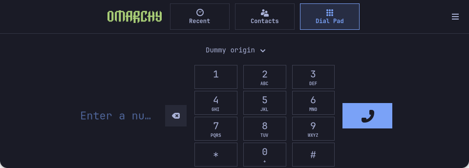

# Independent Android apps and guarded Home rotation

**2026-11-02 · one Xiaomi Mi 10T Pro development unit.** Native R9 is installed;
individual APK cold launch and the focused Home/rotation cycle passed. Wider
physical interface/hardware acceptance is incomplete. [Structured results](evidence/2026-11-02-rotation-layout-followup.json).

| Result | Verified scope |
| --- | --- |
| Individual APK icon | Normal F-Droid cold launch starts Android in the background and opens its own window; zero Android Home/generic surfaces |
| Home during rotation | Focused cycle with rotation 0.3.1-2 / shell 20: guard armed and empty Home retained in both orientations with one background F-Droid window |
| Reopen the app | Normal launcher disabled the live guard and opened the app; no forced focus, task close or global noFocus policy |
| Bars/search | Automatic no-app/no-focus cycle: portrait432-wide44/44, landscape960-wide32/28; Search 408×48 |
| Physical bars | **PASS:** both bars remained correct through vertical→horizontal→vertical without opening an app; this does not validate all APKs/gestures/layouts |

## APKs remain Android apps, with their own Omarchy icons

Waydroid **1.6.3.apollo2-1** / Apollo profile **1.0.0-6** preserves individual
desktop Name/Icon/StartupWMClass metadata and hides the generic Android launcher.
The cold-start test used the normal F-Droid icon, with no show-full-ui,
direct LXC command, APK/image reinstall or API/GPU/network retest. APKs run in an
ARM64 Android container using the real CPU/GPU; they are not converted into native
Linux executables. “Close Android” remains available separately.

Android 13/API 33 boot, Freedreno/Adreno rendering, HTTPS 204, APK-handler/MIME,
activity/process and a normal stop/reopen cycle have their own earlier results.
The normal launcher gives apps their own screen; a tiled viewport did not prove
F-Droid incompatible. F-Droid is resizable with **Auto** orientation, with no
special forced-portrait default. [Android/APK evidence](evidence/2026-11-02-android-runtime-apk.json).

## Narrow, temporary Home protection

The guard selects the most recent eligible background Android class only while
rotating from empty Home. A named rule retains the original workspace with
silent placement, float and maximize for up to **5 seconds**. Generation checks,
activation and timeout cleanup prevent an older callback affecting a new app
activation. Normal cmd_app cancels the rule before normal focus.

The definitive real cycle observed guard armed and empty Home in both T0/T1,
with one background F-Droid window. Reopening the app changed the live guard from
enabled to disabled and the app opened normally. Owner/session/compositor and
other components were preserved; Android was not stopped for this cycle and
no kernel/partition change occurred. The acknowledged requested-touch state is
**not hardware matrix readback**. This proves the specified case, not every APK,
task, process, multi-surface app, orientation sequence or touch behavior.

The restart also adopted the last acknowledged output/requested-touch pair.
The 94host ARM-Lua/simulated-interface checks remain distinct from the real
compositor and cycle results. [Exact guard source and limits](../experiments/mobile-rotation/layout-followup/home-guard-followup/README.md).

### Cleanup scope

Installed rotation 0.3.1-3 changes only cleanup: when the original floating state
was known false, the matching old surface can also be restored. 104focused
assertions and the live compositor namespace/function update plus inactive-rule
response passed. The real Home/reopen cycle above was on 3.1-2; no extra rotations
or broad suites were repeated for the cleanup revision. The observed reopened
F-Droid window was floating and its pre-guard baseline was not recorded, so
**actual float-off or tiling restoration is not verified**.

## Compact panels and native Phone

Shell 20 retains the exact Bar/Launcher 19 QML, with the real QuickshellScreenInfo
geometryChanged signal. The accumulated16→19 source patch reconstructs both
files byte-for-byte. The existing install script and unrelated payloads remain;
the launcher20 delta adds guard cancellation in cmd_app. Landscape reserves 32px
top/28px bottom; portrait 44/44. Search stays 408×48 with font 14/icon 18. Numeric
and source checks do not replace physical acceptance: the earlier physical bar
failure remains historical; the later physical bar cycle passed without opening an app.

Calls **51.1.apollo4-1** changes two UI files: a compact logo/navigation header
and zero outer vertical dialpad padding. 197C/header/provider paths stay unchanged.
The normal graphical-session/D-Bus path opens it on its own workspace, without a
manual post-launch move. Fresh real-GTK fixtures with two dummy origins passed
960×344 and 432×916, 12 key/3 navigation hit targets≥44px, ancestor clipping and zero
template errors. They are host fixtures, not a phone or new voice/audio test.

[Phone source/licenses](../patches/phone-omarchy/README.md) ·
[Session unit](../experiments/calls-session/README.md) ·
[Exact shell/rotation source](../experiments/mobile-rotation/layout-followup/README.md).

## Generic app orientation and its limits

Exact user compatibility rules take precedence over Android launcher-activity
hints; unknown/adaptable apps and empty Home use the sensor. The public override
config contains zero rules. Android portrait enums 1/7/9/12 and landscape 0/6/8/11
map to axes; other values remain auto. Secondary activities and dynamic
setRequestedOrientation are not fully described by this provider. It does not
read searches, accounts, views or app data or log live app inventories.

The focused temporary override test passed portrait output T0/requested touch 0,
empty-Home sensor T1 and exact original config-byte restoration: zero permanent
rules remained and F-Droid returned to Android Auto/T1. Profile 5's retained
0755 hints-parent fix passed ordinary-user reading and real GIO replacement
events without restarting Android or repeating the runtime/API/GPU/APK checks.
[Public contract](../experiments/mobile-rotation/layout-followup/CONTRACT.txt).

## Provenance, permissions and remaining work

[Fourteen exact profile payloads, three modified GPL Python sources, generic
desktop entry, patch and licenses](../experiments/waydroid-apollo/README.md) are
public. No packages, pyc, images, APK binaries, generated policies, live device
inventory, signing material or raw diagnostics are included. Official public
images were checked by channel size/SHA256 and ZIP CRC; this is not an independent
detached-image-signature claim. The source patch removes broad raw-video,
framebuffer and debugfs exposure. Apollo uses MSM/Freedreno, without the inherited
Pixel/Mali adapter. The generated LXC policy grants no blocks; its specific
c1:11 wm rule grants no read, without proving global root/kernel-log isolation.

**No Google Play/GMS is included.** Play Integrity, banking, DRM, arbitrary
APK/API/ABI compatibility and Android camera/microphone/GPS remain unverified.
No battery/performance ratio is claimed. R9 boot/login, earlier SIM continuity,
outgoing/downlink voice and cellular IPv4 retain their separate scopes. Incoming
calls, microphone/uplink, SMS, wider sensors/radios, physical suspend, battery life,
clean-first-account/login and a public installer remain unfinished. The regular
Mi 10T 5G is [unvalidated](compatibility.md).
