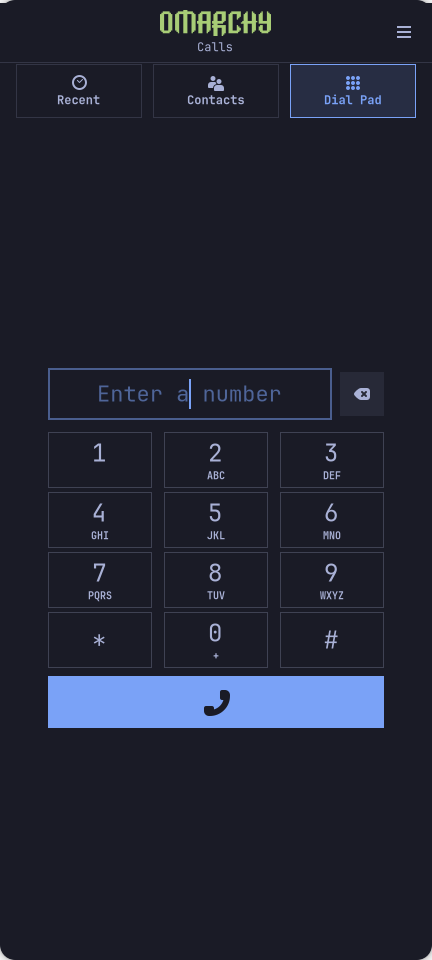
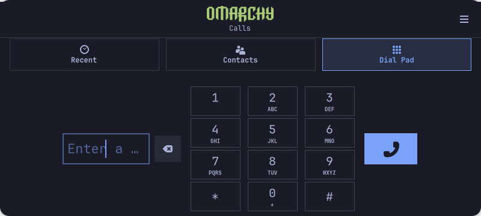

# Native R9, accepted desktop and Omarchy Phone

**2026-11-02 · one Mi 10T Pro development unit · installed results, not a generic release.**
This grouped update supersedes the earlier R6/cold-login checkpoint where listed.
It preserves the earlier trials as historical evidence. [Machine-readable scope](evidence/2026-11-02-installed-mobile-batch.json).

| Component | Installed and observed | Boundary |
| --- | --- | --- |
| Native kernel | **7.1.0-apollo-native-r9** committed and normal boot verified; Landlock **ABI9** and integrity of **503 modules** passed | Recovery/DTBO retained; no unit images/modules distributed or full-hardware claim |
| Desktop | **Hyprland 0.57.0-2.1**, targeted upstream DMA-BUF feedback backport; desktop accepted after normal reboot | Supersedes the earlier open black-center checkpoint for this tested configuration, not an unlimited reliability guarantee |
| Omarchy Phone | **GNOME Calls 51.1.apollo3-1**, original logo, framed dialer and mobile layouts; main screen human-accepted | Four real-app synthetic viewports; active-call/account/DTMF states not covered by those fixtures |
| SIM continuation | **0.2.2-1**, installed; uninterrupted flow accepted in the same reboot test | No automatic retry; SIM access PIN remains separate from Linux login |
| Navigation | HOME, recents, keyboard close and final-app-close→Home human-accepted | Further accessibility and app-specific refinement remain useful |
| Rotation | **0.2.0-2** installed/enabled/active; sensor-triggered transform observed | Physical display-and-touch orientation acceptance still pending |
| Video follow-up | Venus H264 diagnostic completed **180 frames / 6 seconds**, exit0 | Earlier intermittent abort did not recur in this pass; cause remains unknown, no speed/battery ratio |
| Android apps | Waydroid installation in progress | No verified Android runtime, GPU acceleration, APK or Google Play acceptance yet |

## Phone layout, with private data kept out

Both images are **host renders of the real application with synthetic/empty data**,
not phone captures. The full main window passed 432×960, 432×520, 800×360 and
360×756: 12 key hit targets, three navigation targets, entry/delete/call control
inside the viewport, targets at least 44 px, zero dial signals and zero GTK/CSS/
template warnings. The original MIT Omarchy logo is unchanged. No real number,
account, contact, message, subscriber information or credential is shown.

The visual adaptation preserves C/backend/logger/provider sources and the installed
provider binaries. Portrait/landscape rendering and human main-screen acceptance
do not establish all call states or modem behavior. The separate R19 manually
dialed voicemail/downlink result remains valid; microphone/uplink, incoming calls,
SMS, AEC and VoLTE path are still unverified.

## Reviewable source

- [Three unchanged upstream Hyprland patches](../patches/hyprland-dmabuf/README.md), with public commit pins and original attribution.
- [Phone patch sequence and original logo notice](../patches/phone-omarchy/README.md), including the exact source-byte reconstruction detail.
- [SIM continuation payload](../experiments/sim-continuation/README.md), separate from the historical 0.1.3 experiment.
- [Rotation source and model-level baseline](../experiments/mobile-rotation/README.md), with physical acceptance explicitly pending.

These are selected source records, not a complete public installer or redistributable
unit image. No package/signature archive, private key, firmware, calibration, raw
diagnostic, private screenshot or network/subscriber configuration is included.
File-specific licenses and original authorship are retained.

## Remaining work

First-user userland 0.1.0-3 / native profile 20261101-11 is installed on R9. Normal
signature/ALPM/integrity, SDDM and sudoers checks passed while preserving the existing
owner-ready state and running UI/SIM/rotation. The new-owner wizard was not activated
for the configured owner. **Creating a first account and its real first SDDM/logind
login remain untested**; existing-owner integration does not establish that flow. GPS, fingerprint, proximity, IR
transmission, Bluetooth pairing/audio, IPv6, wider cellular/phone coverage,
physical suspend/wake and battery life remain open. The earlier USB-derived
0.47 W claim remains withdrawn. No power, battery-life or general speed gain is
claimed from successful package checks or one video pass.

The regular Mi 10T 5G remains unvalidated: see [model compatibility](compatibility.md).
This project is independent of Omarchy, Xiaomi and the upstream projects.
