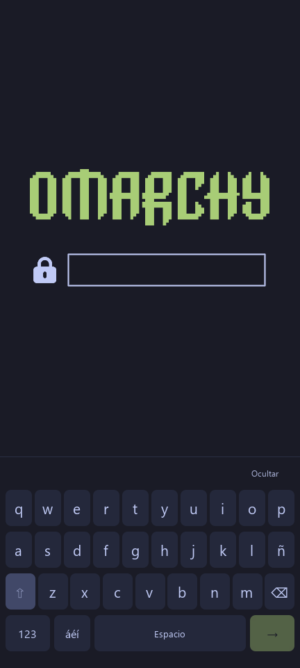

# Original Omarchy boot and login — V2 experiment

The original **Omarchy 4.5 RC2** appearance, fitted to Apollo's portrait display. The official PNG assets are unchanged, the background is `#1a1b26`, and the initial 432×960 QML render matches the upstream reference pixel for pixel. Touch input appears when the credential field is tapped.

**Status:** native Plymouth was exercised in **R16, a minimal RAM rescue session**. The SDDM theme loads with real ARM64 Qt/SDDM in test mode, but **PAM login on the phone is untested**. No OS password/PIN was configured by this theme, no active theme or autologin/PAM policy was changed, and this is not a permanent installation. **R19 is the latest full-desktop trial:** one manual outgoing voicemail call and audible downlink were verified. R18/R19 returned automatically while R17 needed buttons; general return reliability remains unproven. R13 Wi-Fi retains its scope. See [current status](../../docs/status.md).

[Español / integración](INTEGRACION.txt) · [Current hardware status](../../docs/status.md) · [R16 evidence](../../docs/evidence/2026-11-01-r16.json)

## Three different kinds of image

| Native R16 Plymouth capture | Initial SDDM Qt render | SDDM touch-keyboard Qt render |
| --- | --- | --- |
|  |  |  |

The left image is a reviewed **1080×2400 native KMS framebuffer capture**. It contains generic branding only, a standard sRGB color tag and no text/EXIF metadata. It is not the HTML preview. A separate user confirmation of the final R16 screen was not obtained. The other two images are Qt renders of the source. [The reference render](previews/upstream-reference-432.png) is byte-identical to the initial mobile render.

The self-contained [offline HTML preview](preview.html) toggles between embedded renders. Download it to view locally; it contains no credential input/form and makes no network connections. It does not authenticate.

## What changes in the theme

- Preserve the original Omarchy wordmark, lock, entry, bullets and error images, with upstream MIT notices.
- Uniformly scale the original SDDM composition for portrait output. Keep the touch keyboard hidden until the field is tapped, then move the composition above it.
- Provide letters, Shift, symbols, Spanish characters and Unicode-aware deletion. Keep ordinary physical input and UWSM session selection.
- Submit through normal `sddm.login(user, credential, session)` and clear the field on submission. There is **no hardcoded credential or fixed PIN length**. Account/PAM policy determines acceptance.
- Use a local QML keyboard, with no QtVirtualKeyboard dependency. This SDDM keyboard does **not** implement touch-based LUKS unlocking in Plymouth.
- Retain the original Plymouth dialogue/animation logic and fit its layout to smaller outputs. The upstream animated bar is **not a measured boot percentage**, and it must not impose a minimum wait before the desktop can start.

## Validation boundaries

| Check | Recorded result | Scope |
| --- | --- | --- |
| Windows Qt 6.10.2 | 17 functional/render checks, no QML messages | Offscreen rendering and a rejecting mock backend; no PAM |
| Offline browser preview | 6 checks | Embedded images, toggle, no credential forms, mobile width |
| Plymouth parser 26.134.222 | Parse and callback checks passed | Parser/API review; its report predates the physical trial |
| ARM64 Qt 6.12.0-3 / SDDM 0.21.0-7 | Actual target test-mode theme load passed | Test mode, not authentication or a phone login |
| PC builder package | `apollo-mobile-boot 0.2.0-1`, normal GPG/ALPM verification, 35 integrity entries | Prepared in the builder; active theme selection unchanged |
| Apollo R16 | Plymouth daemon, DRM and active VT checked; native KMS image captured; zero XKB errors in collected rescue log | Minimal RAM rescue, **not a full desktop or SDDM/PAM acceptance test** |

The small [review records](review/README.md) retain their original test scopes. R16 observed **18,304 KiB RSS in one daemon sample**. That single rescue-session sample is not a performance, boot-time or percentage comparison. Original boot/DTBO readbacks matched after the automatic Android return; all 122 observed UFS nodes were read-only. No private calibration was staged in R16.

## Review and stage source

`native/` contains the Plymouth and SDDM themes. `stage.py` creates **a new package tree only**:

```sh
python3 stage.py --output /path/to/a/new/apollo-original-stage
```

It refuses an existing destination and does not write active configuration under `/etc`, select a theme, change accounts or regenerate boot files. The repository does not provide a validated end-to-end installer for the new phone profile. Integrating the splash, greeter and first local credential with the full desktop still needs a supervised test and recovery validation.

The MIT [capture helper source](tools/capture_splash.c) is included for review, without a binary. It requires an explicit RAM-splash marker and the Apollo device-tree compatible string. It queries KMS and maps the buffer with `PROT_READ`; it does not request DRM master or perform modesetting. The DRM device descriptor is opened read/write for those queries. Every image still requires a privacy review before publication.

## Sources and licenses

Original design and assets: **David Heinemeier Hansson / Omarchy**, MIT, commit [`5978d93ae7da0a325b7493501911e3f1266cadd3`](https://github.com/omacom/omarchy/tree/5978d93ae7da0a325b7493501911e3f1266cadd3). See the original [SDDM theme](https://github.com/omacom/omarchy/tree/5978d93ae7da0a325b7493501911e3f1266cadd3/default/sddm/omarchy) and [Plymouth theme](https://github.com/omacom/omarchy/tree/5978d93ae7da0a325b7493501911e3f1266cadd3/default/plymouth).

[Asset provenance and Git blobs](source-manifest.json) · [Adaptation MIT license](LICENSE) · original `LICENSE-Omarchy` in each native theme directory · [repository license scope](../../LICENSES/README.md).

This is an independent device adaptation; it does not imply upstream or Xiaomi endorsement. Qt, SDDM and the Plymouth parser are external review/runtime dependencies, not redistributed toolchains in this directory.
