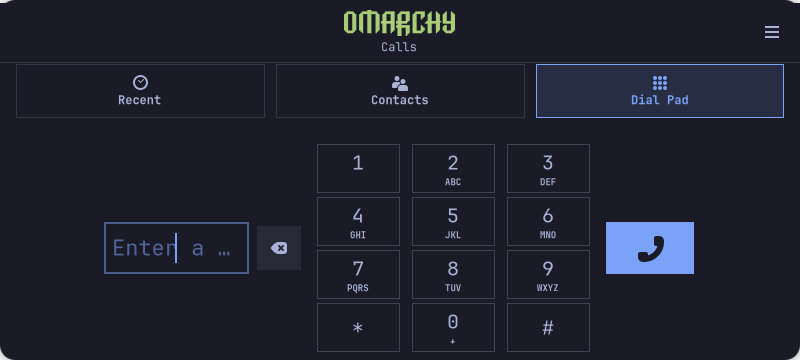

# Omarchy Phone: Calls 4 landscape follow-up

**Installed: 51.1.apollo4-1. Normal mobile-launcher/D-Bus activation is verified;
physical rotation/layout acceptance is pending.** Apply `0005-landscape-safearea.patch`
after the four earlier patches and exact style reconstruction described below.
The patch changes only the Calls main-window UI and libcall-ui dialpad UI; both
exact final files are included in `followup-51.1.apollo4/`.197 C/header/provider
paths stay unchanged. The source licenses remain GPL3+ and LGPL2.1+ respectively.

Fresh real-GTK sandbox fixtures used two dummy origins at 960×344 and 432×916:
12 key hits,3 navigation hits, targets at least 44px, ancestor-clip checks and zero
template errors passed. These are fresh fixture windows, not proof that every
compositor/backend resize sequence or physical rotated call state works.

The compact header shares the logo/navigation row in short landscape layouts;
zero outer vertical dialpad padding keeps the last keypad row inside the area.
The [session-unit integration](../../experiments/calls-session/README.md) replaces
GNOME-only targets with the real graphical-session target. Shell 16 also preserves
the app's own screen after cold D-Bus mapping; normal activation required no manual
post-launch move. No telephony backend change or new call/audio test is claimed.

## Earlier Calls3 source and four-viewport evidence

# Omarchy Phone: source delta and visual checks

Installed and human-accepted on the development phone as **GNOME Calls
51.1.apollo3-1**. These are source inputs, not a package or phone installer.

Start with the [GNOME Calls 51.1 release](https://download.gnome.org/sources/calls/51/),
verify the [source checksum](SOURCEPINS.json), then apply the four patches in the
listed order. Copy the unchanged `omarchy-logo.png` to `src/omarchy-logo.png`
before patch 4. After patch 4, copy `phone-style.css` to `src/style.css`: this
preserves the exact reviewed CRLF source bytes, which the textual diff normalizes.
Keep the existing Apollo build/provider integration; this directory is not a
complete replacement packaging recipe.

The main window uses the original Omarchy logo, framed controls, readable mono
digits, three navigation tabs and a mobile portrait/landscape layout. The logo
is not redrawn or recolored. GTK palette integration is separate; the previews
use public Tokyo Night CSS in an empty fixture home. The three previous patches
are retained exactly, including private-by-default logging. The latest UI delta
changes ten UI/CSS/resource paths; 197 C/header/provider source paths remain
identical. The installed package preserved unrelated provider binaries and data.

Full **real application** fixtures used a dummy provider, isolated bus and empty
home at 432×960, 432×520, 800×360 and 360×756. All 12 keys, three navigation
targets, entry/delete and call control fit; targets were at least 44 pixels.
The menu measured 44×53 and original logo 112×26. Input roundtrip/IME checks
passed, with zero dial signals and zero GTK/CSS/template warnings. These are
host fixtures, not calls made on a device. Human acceptance after normal reboot
later confirmed the installed main screen.

The active-call, account and DTMF screens were not exercised by these fixtures.
The earlier outgoing/downlink result remains separate; microphone, incoming calls
and SMS are still unverified. No performance or battery improvement is measured.

Calls-derived UI/style/resources remain **GPL-3.0-or-later**; libcall-ui UI/style
remain **LGPL-2.1-or-later**. The additional style/script notice does not relicense
either upstream. The unmodified Omarchy logo retains **David Heinemeier Hansson's
MIT notice**. See the included licenses and [file-scope attribution](../../LICENSES/README.md).
